# Module dependency graph (HDF tidefile focused)

This file shows a focused module dependency graph for the HDF tidefile component and its immediate dependencies.

```mermaid
flowchart TD
  %% HDF tidefile component modules
  hdf_tidefile["hdf_tidefile"]
  hdfvars["hdfvars"]
  inclvars["inclvars"]
  objvars["objvars"]
  qextvars["qextvars"]
  mod_hdf5_init["mod_hdf5_init"]
  mod_tide_time["mod_tide_time"]
  dsm2_tidefile_input_storage_fortran["dsm2_tidefile_input_storage_fortran"]

  %% Common/Qual modules used by HDF tidefile
  common_tide["common_tide"]
  grid_data["grid_data"]
  runtime_data["runtime_data"]
  iopath_data["iopath_data"]
  IO_Units["IO_Units"]
  logging["logging"]
  HDF5["HDF5"]
  h5lt["h5lt"]
  network["network"]
  utilities["utilities"]
  groups_data["groups_data"]
  qual_param["qual_param"]
  bltm["bltm"]

  %% Edges (module -> used module)
  hdf_tidefile --> mod_tide_time
  hdf_tidefile --> mod_hdf5_init
  hdf_tidefile --> IO_Units
  hdf_tidefile --> logging
  hdf_tidefile --> common_tide
  hdf_tidefile --> runtime_data
  hdf_tidefile --> iopath_data
  hdf_tidefile --> inclvars
  hdf_tidefile --> HDF5
  hdf_tidefile --> hdfvars
  hdf_tidefile --> grid_data
  hdf_tidefile --> chconnec["chconnec (only: QRes)"]
  hdf_tidefile --> qextvars
  hdf_tidefile --> dsm2_tidefile_input_storage_fortran
  hdf_tidefile --> h5lt
  hdf_tidefile --> network
  hdf_tidefile --> utilities
  hdf_tidefile --> groups_data
  hdf_tidefile --> qual_param
  hdf_tidefile --> bltm

  %% hdfvars/inclvars/qextvars/objvars dependencies
  hdfvars --> HDF5
  hdfvars --> iopath_data
  inclvars --> gtm_precision["gtm_precision"]
  objvars --> HDF5
  qextvars --> HDF5

  %% transitive common dependencies (representative)
  dsm2_tidefile_input_storage_fortran --> HDF5
  dsm2_tidefile_input_storage_fortran --> input_storage_fortran["input_storage_fortran"]

  %% Qual/bltm links (why 'bltm' appears)
  bltm --> dsm2_common_qual["dsm2_common_qual"]
  bltm --> grid_data
  dsm2_tidefile_input_storage_fortran --> grid_data

  %% cluster styling
  subgraph HDF_TIDEFILE_COMPONENT[HDF tidefile component]
    hdf_tidefile
    hdfvars
    inclvars
    objvars
    qextvars
    mod_hdf5_init
    mod_tide_time
  end

  subgraph COMMON_MODULES[Common / Qual / HDF ecosystem]
    common_tide
    grid_data
    runtime_data
    iopath_data
    IO_Units
    logging
    HDF5
    h5lt
    network
    utilities
    groups_data
    qual_param
    bltm
    dsm2_tidefile_input_storage_fortran
    dsm2_common_qual
    input_storage_fortran
    gtm_precision
  end

``` 

Notes:
- This diagram is focused on the HDF tidefile area and shows the direct `use` relations observed in `hdf5_modules.f90`, `read_mult_tide.f90`, and `qual_process_tide.f90`.
- I intentionally included only immediate neighbors to keep the graph readable; there are many more transitive dependencies across the repo.
- If you want a complete repository-wide dependency graph (all modules and edges), I can generate that, but it will be large and may be split across multiple pages.

Generated on: 2025-11-10
